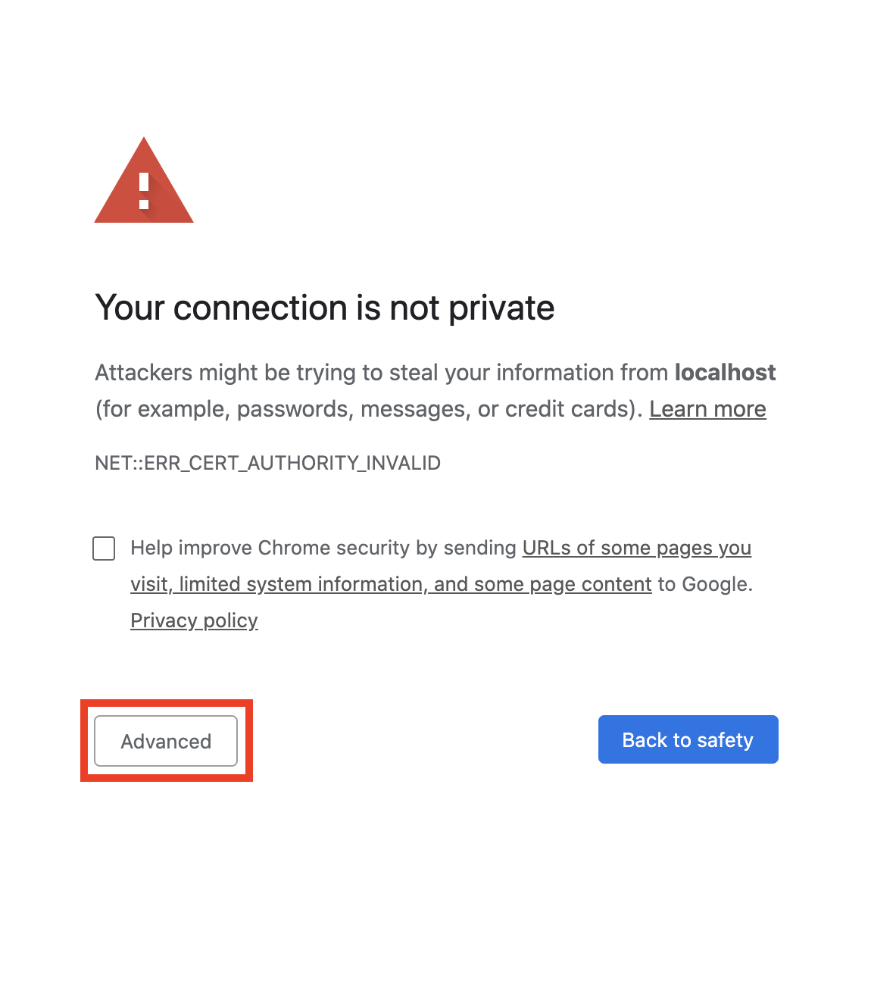
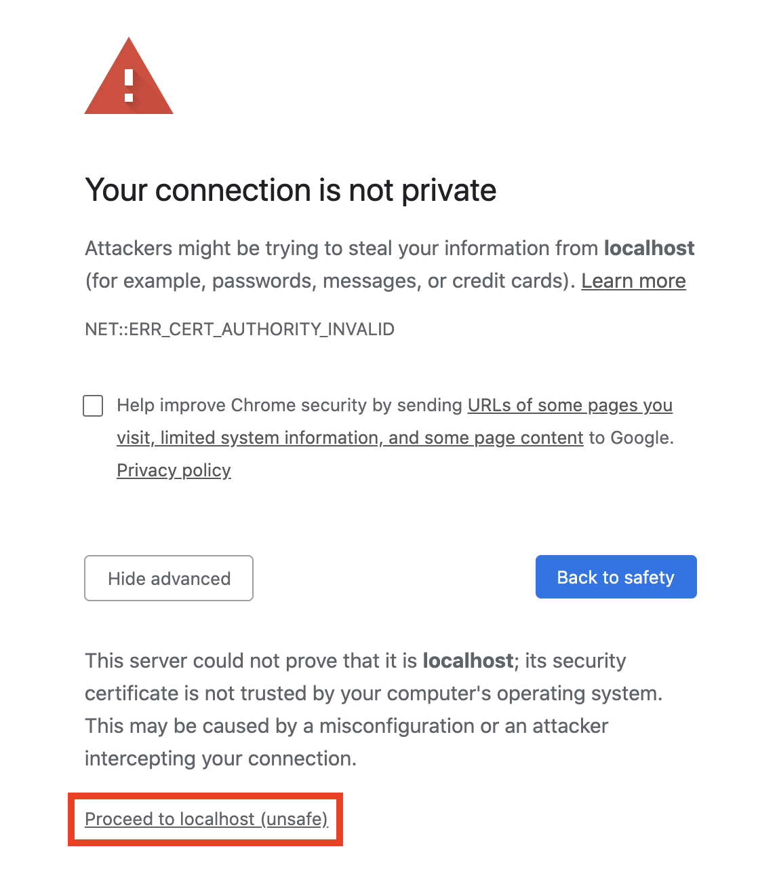
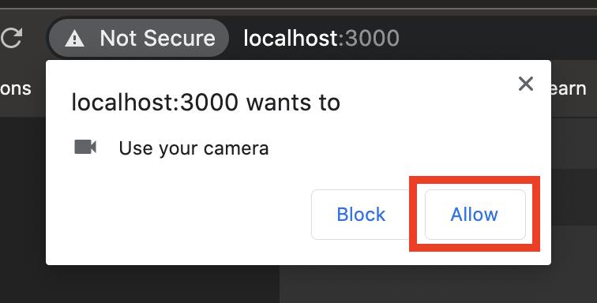
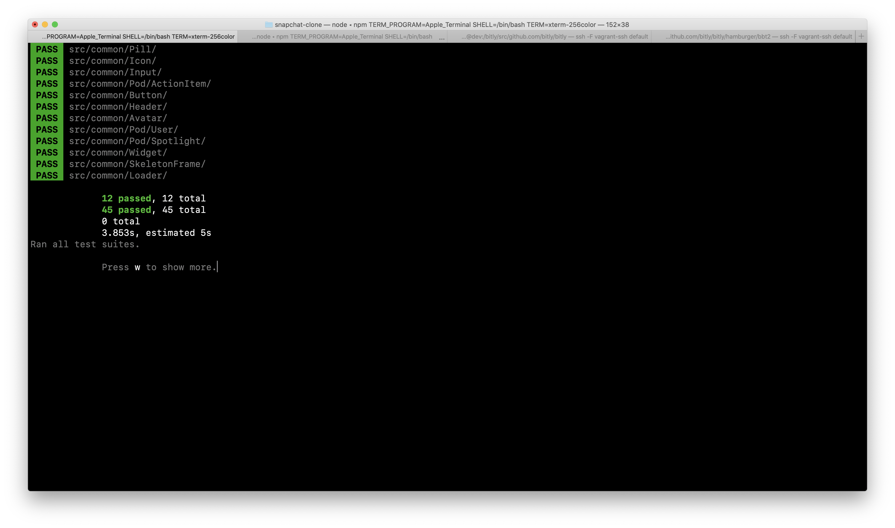
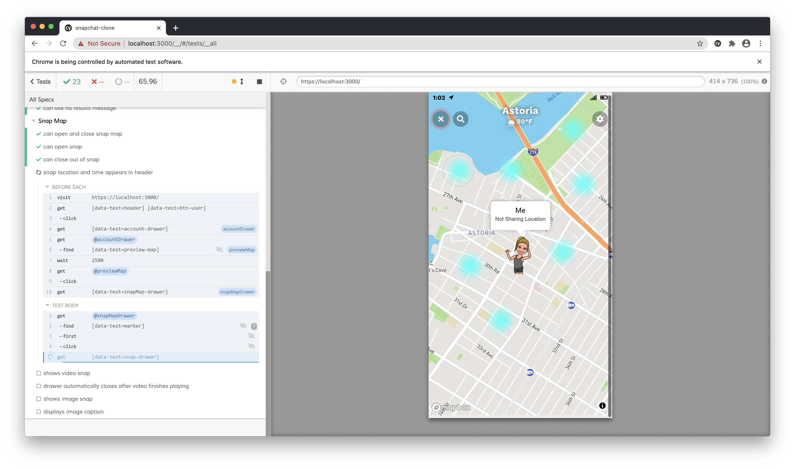
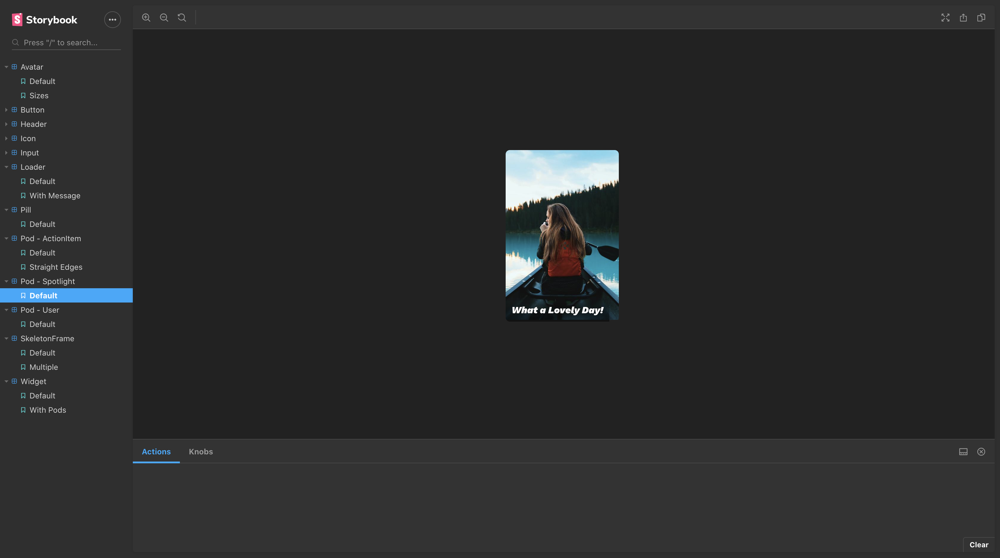
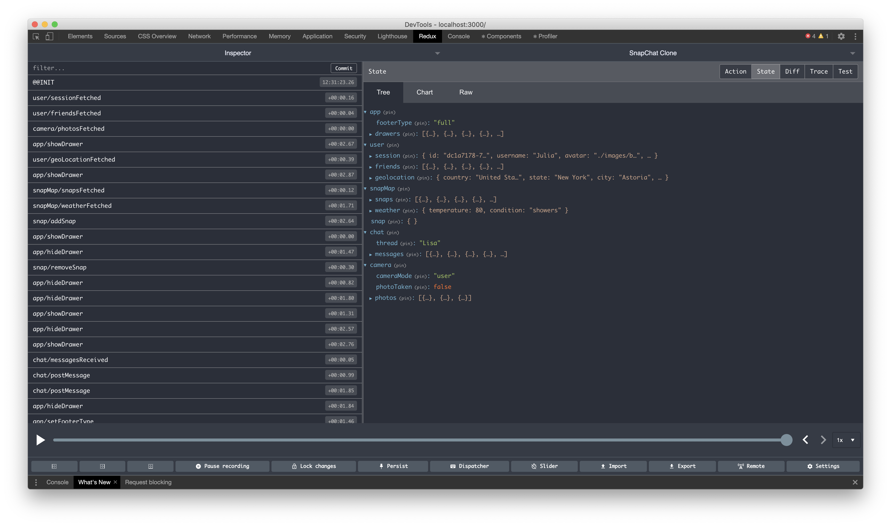
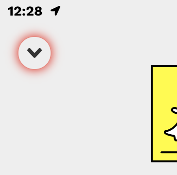

# 👻 Snapchat Clone

> A front-end recreation of Snapchat built with **React**, **Redux Toolkit** and **TypeScript**. It includes live camera face filters, a snap map, chat screens and a custom component library.


**[🚀 Live App](https://towhidkashem.github.io/snapchat-clone/)** · **[🎬 Video Demo](https://www.youtube.com/embed/aRS88v-duKg?autoplay=1)**

---

## 📚 Table of Contents

- [Tech Stack](#-tech-stack)
- [Quick Start](#-quick-start)
- [Available Scripts](#-available-scripts)
- [Project Structure](#-project-structure)
- [Architecture Highlights](#-architecture-highlights)
- [Testing](#-testing)
- [Developer Tooling](#-developer-tooling)
- [Using the Demo](#-using-the-demo)
- [Notes](#-notes)
- [Contributing](#-contributing)

---

## 🧰 Tech Stack

| Area | Technology |
| --- | --- |
| UI | React (function components and hooks) |
| State | Redux Toolkit, React-Redux hooks, Redux Thunk |
| Language | TypeScript |
| Styling | SASS |
| Build | Webpack (via Create React App), Gulp for the filter scripts |
| Testing | Jest, Enzyme, Cypress |
| Code quality | ESLint, Prettier (pre-commit hook) |
| Component docs | Storybook |
| Maps | Mapbox |
| Face filters | [jeelizFaceFilter](https://github.com/jeeliz/jeelizFaceFilter) |

---

## ⚡ Quick Start

### Prerequisites

- Node.js and npm
- Git with SSH access to GitHub (the install step clones `jeelizFaceFilter` over SSH)
- A webcam (for the camera and filters)

### 1. Clone and install

```bash
git clone https://github.com/thecreativenick/sanpchat.git
cd sanpchat
npm install
```

`npm install` also runs a post-install step that:

1. Clones the `jeelizFaceFilter` package into `public/filters/` and pins it to the last version this project was tested with.
2. Runs `gulp` to concatenate, minify and transpile `public/filters/src/*.js` into a single `filters.min.js`.

### 2. Add a Mapbox key (optional, recommended)

The snap map features need a Mapbox token. [Get a free API key](https://docs.mapbox.com/help/glossary/access-token/), then update `.env`:

```diff
- REACT_APP_MAP_BOX_API_KEY=REPLACE_WITH_API_KEY
+ REACT_APP_MAP_BOX_API_KEY=xy.abc123
```

### 3. Run it

```bash
npm start
```

The app opens at **https://localhost:3000/**.

> **Why the browser warning?**
> The camera's `getUserMedia` API only works over HTTPS, so the dev server uses a self-signed certificate. In Chrome, click **Advanced → Proceed to localhost (unsafe)**, then click **Allow** when asked for webcam access.

| Step 1 | Step 2 | Step 3 |
| :---: | :---: | :---: |
|  |  |  |

You're all set! 🎉

---

## 📜 Available Scripts

| Command | What it does |
| --- | --- |
| `npm start` | Starts the HTTPS dev server |
| `npm run build` | Builds the production bundle into `build/` |
| `npm run deploy` | Builds and publishes to GitHub Pages |
| `npm run test` | Runs the Jest unit tests |
| `npm run e2e` | Opens the Cypress test runner |
| `npm run e2e-headless` | Runs Cypress in the terminal and records videos |
| `npm run storybook` | Starts Storybook on port 6006 |
| `npm run gulp watchJS` | Rebuilds the filter scripts when they change |
| `npm run cleanup` | Removes `node_modules`, `build` and the filter dependency |

---

## 🗂 Project Structure

```text
src/
├── AppShell/      # App layout and routing shell
├── components/    # Shared, reusable UI components (with unit tests)
├── features/      # One folder per feature: components, styles, store, tests
├── styles/        # Global SASS variables, mixins and extendables
├── types/         # Shared TypeScript types
└── utils/         # Helper functions
public/
├── api/           # Mock JSON "API" responses
└── filters/       # Face filter sources and build output
cypress/
└── integration/   # End-to-end specs
```

---

## 🏗 Architecture Highlights

**React**
- Uses only function components with hooks.
- The folder structure is **flat** (at most one level deep) and **organized by feature** instead of the usual "components/containers" split.
- Each feature folder holds everything that feature needs, so deleting the folder removes the feature completely.
- Has few production dependencies.

**Redux**
- Uses **Redux Toolkit**, which removes most of the usual boilerplate.
- Each feature has a single `store.ts` holding its actions and reducers. The action creators are generated automatically.
- Keeps the state tree flat. Built-in **Immer** support allows safe "mutating" updates instead of chains of spread operators.
- Reads state and dispatches actions with the `useSelector` and `useDispatch` hooks instead of `connect`.
- Handles async work with **thunks**. Works with the **Redux DevTools Extension**.

**Styling**
- Each view's SASS rules are nested under a single parent element to prevent style clashes.
- Variables, mixins and extendables keep the styles consistent.

**TypeScript**
- Catches bugs at build time instead of in front of users.

**Mobile**
- Feels close to a native app when you add it to your home screen.

---

## 🧪 Testing

### Unit tests (Jest + Enzyme)



- Every shared component in `components/` has `*.test.tsx` files next to it.
- Run them with `npm run test`.
- They also run on each commit. If a test fails, the commit is rejected.

### End-to-end tests (Cypress)

[](https://www.youtube.com/embed/tNrx6NlTYKI?autoplay=1)

*Click the image to watch the full suite run.*

- The specs are in `cypress/integration/*.spec.ts` and cover the happy path of every main feature.
- Selectors use `data` attributes instead of classes or IDs, so styling changes don't break tests.
- **Interactive:** start the app with `npm start`, run `npm run e2e`, then click **Run all specs**.
- **Headless:** run `npm run e2e-headless`. Videos are saved to `cypress/videos/`.

---

## 🛠 Developer Tooling

| Storybook | Redux DevTools |
| :---: | :---: |
|  |  |
| Browse the custom component library with `npm run storybook`. | View the state tree and action flow. Install the browser extension for [Chrome](https://chrome.google.com/webstore/detail/redux-devtools/lmhkpmbekcpmknklioeibfkpmmfibljd?hl=en) or [Firefox](https://addons.mozilla.org/en-US/firefox/addon/reduxdevtools/). |

---

## 🦮 Using the Demo



This is a minimal demo, so not every button works. Buttons that work but aren't obvious are marked with a **red box-shadow**.

The [video walkthrough](https://www.youtube.com/embed/aRS88v-duKg?autoplay=1) shows everything you can currently do.

<br clear="right" />

---

## 📝 Notes

- **Mock data:** the app is front-end only. The "API" is a set of static JSON files in `public/api/*.json`.
- **Clean imports:** `baseUrl` in `tsconfig.json` is set to `src`, so you can write `import Foo from 'components/Foo'` instead of relative paths. SASS supports the same thing: `@import '~styles/foo';`.
- **Editing filters:** after changing files in `public/filters/src/*.js`, run `npm run gulp watchJS` so the changes are rebuilt.

---

## 🤝 Contributing

This project is part of a personal portfolio, so pull requests aren't being accepted. You're welcome to fork it and maintain your own version.
